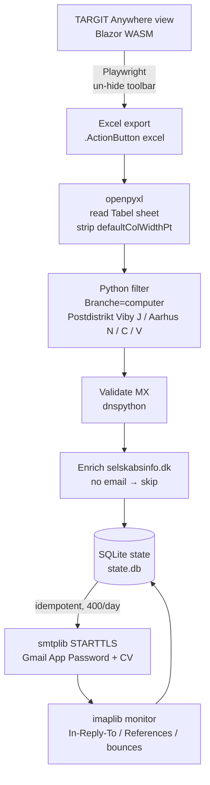
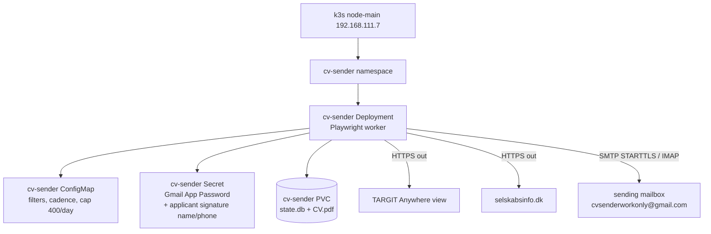

# ADR-612: Adopt cv sender for browser-automated erhvervspraktik outreach

## Context and Problem Statement

Aarhus Kommune publishes an erhvervspraktik company list as a **TARGIT Anywhere**
Blazor WebAssembly view. The table is client-rendered and absent from the served
HTML, so `requests` + BeautifulSoup returns an empty shell. The rendered DOM grid
is row-capped (`div.lsCrosstab.hasRowLimit`, ~18 rows), so DOM scraping cannot
extract the full set; the **Export to Excel** action
(`.ActionButton[actionid="excel"]`) returns the full unfiltered list (~37,319
rows), narrowed to the 1,881 computer-branch rows in Python. The toolbar holding
the export button is `display: none`, so the scraper un-hides it, waits for
the rendered header/row-total, then retries until non-empty: both URLs can
0-byte before hydration and a slow hydration can exhaust the retry budget.
`selskabsinfo.dk` sits behind a Vercel bot challenge (HTTP 429), so enrichment
also needs a real browser. No login is required (`#lsLogin` is `display: none`),
so an unauthenticated automated browser reaches both the view and its export.

The homelab needs a repeatable, low-ops worker that extracts, filters, enriches
and contacts companies without committing the CV, the App Password or scraped
data to git. This epic has no Research stage; the problem is recorded here.

## Decision

Build **cv sender** as a containerised, long-running Python worker on node-main
k3s:

- **Runtime**: Playwright (headless Chromium) for rendering, interaction and
  parsing, and the Python standard library (`email.message.EmailMessage`,
  `smtplib`, `imaplib`) for send and monitor.
- **Extraction**: the Excel export, not DOM scraping — the grid is row-capped
  and the export returns the full unfiltered list; the data lives on the `Tabel`
  sheet and the workbook is re-packaged in memory (stripping the
  `defaultColWidthPt` attribute openpyxl 3.1.5 cannot parse) before reading.
- **Filtering**: the TARGIT slicer is not scriptable (`.slicerSelectAll` is
  permanently `display: none`), so the export is unfiltered and Branche is
  selected in Python via a case-insensitive substring match on
  `filters.branche_query`; keep Postdistrikt ∈ {Viby J, Aarhus N, Aarhus C,
  Aarhus V}.
- **Enrichment**: `selskabsinfo.dk` →
  `https://selskabsinfo.dk/virksomheder-i/aarhus`; if still no email, skip the
  company. No CVR/`cvrapi.dk` fallback.
- **Send/monitor**: STARTTLS + Gmail App Password from
  `cvsenderworkonly@gmail.com`, CV attached; `imaplib` reply/bounce detection
  (`In-Reply-To`/`References`); reply notifications go to
  `RyanHarrisZubair@gmail.com` while bounces are flagged and counted in the
  daily digest; idempotent SQLite state so restarts never double-send. 400/day
  cap; rollout dry-run → pilot of 3 → full.
- **Sessions**: TARGIT session GUIDs are resolved by placeholder text at
  runtime and never hardcoded; reverse-engineering private JSON/JWT endpoints
  is rejected.
- **Hardening** — `RuntimeDefault` seccomp, all capabilities dropped, privilege
  escalation disabled, per the Playwright Docker guidance for scraping untrusted
  sites; a dedicated non-root user is a deployment follow-up.

**Gmail limits.** The mailbox is a free `@gmail.com` account, capped at
**500 recipients/day**, so the 400/day cap sits close to that ceiling; the
worker must pace sends and back off on SMTP `4xx`/`5xx`, or Gmail throttles and
can suspend the account.

**Legal and ethical.** This is unsolicited bulk cold outreach: the worker only
contacts publicly listed businesses about a real erhvervspraktik placement.
Each enquiry invites the recipient to opt out, and their details are removed
on request — removal is handled manually from replies in the sending mailbox,
not by automation. Volume stays low, so it is not a spam tool; compliance with
GDPR and marketing rules remains the owner's responsibility.

**Never committed.** The CV, the App Password and scraped data never go to git;
the applicant's signature name/phone moved to the k8s Secret, keeping tracked
config PII-free apart from the deliberately tracked `account.notify_email`
(notification routing, not a credential).

## Fit into Homelab

The worker runs inside the existing single-node k3s cluster:

- **Target**: `node-main` (192.168.111.7), namespace `cv-sender`.
- **Workload**: a Deployment running the Playwright worker image; the CV file
  ships on the PVC, never in the image.
- **State**: a PVC holds `state.db` (SQLite) and the CV attachment.
- **Config/secret**: a ConfigMap holds filters, cadence, and the 400/day cap; a
  Secret holds the App Password and the applicant's signature name/phone.
- **Egress**: outbound HTTPS to the TARGIT view and `selskabsinfo.dk`, and
  SMTP/IMAP to the sending mailbox (`cvsenderworkonly@gmail.com`).

The decision clears the way for the `05_Implementations/` stage: worker image
and manifests, PVC/Secret wiring, dry-run, then the pilot rollout.
