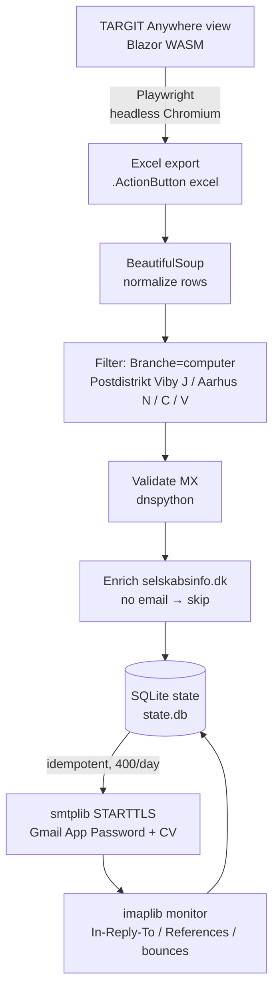
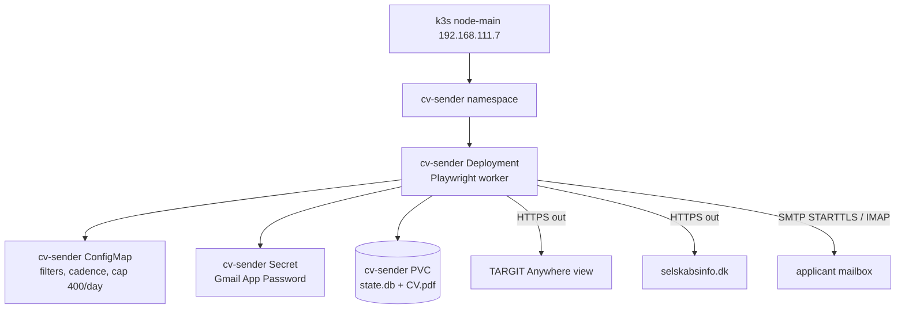

# ADR-612: Adopt cv sender for browser-automated erhvervspraktik outreach

## Context and Problem Statement

Aarhus Kommune publishes an erhvervspraktik company list as a **TARGIT Anywhere**
Blazor WebAssembly view. The table is client-rendered and absent from the served
HTML, so `requests` + BeautifulSoup returns an empty shell. The rendered DOM grid
is row-capped (`div.lsCrosstab.hasRowLimit`, ~18 rows), so DOM scraping cannot
extract the full set; the **Export to Excel** action
(`.ActionButton[actionid="excel"]`) returns the full filtered set (~1,882 rows).
`selskabsinfo.dk` sits behind a Vercel bot challenge (HTTP 429), so enrichment
also needs a real browser. No login is required (`#lsLogin` is `display: none`),
so an unauthenticated automated browser reaches both the view and its export.

The homelab needs a repeatable, low-ops worker that extracts, filters, enriches,
and contacts companies without committing personal data or secrets to git. This
epic has no Research stage; the problem and constraints are recorded here.

## Decision

Build **cv sender** as a containerised, long-running Python worker on node-main
k3s:

- **Runtime**: Playwright (headless Chromium) for rendering and interaction,
  BeautifulSoup for parsing, and the Python standard library
  (`email.message.EmailMessage`, `smtplib`, `imaplib`) for send and monitor.
- **Extraction**: the Excel export, not DOM scraping — the grid is row-capped
  and the export returns the full filtered set.
- **Filtering**: type `computer` into `input[placeholder="Search Branche"]`
  then click `.slicerSelectAll`; keep Postdistrikt ∈ {Viby J, Aarhus N,
  Aarhus C, Aarhus V}.
- **Enrichment**: `selskabsinfo.dk` →
  `https://selskabsinfo.dk/virksomheder-i/aarhus`; if still no email, skip the
  company. No CVR/`cvrapi.dk` fallback.
- **Send/monitor**: STARTTLS + Gmail App Password from
  `RyanHarrisZubair@gmail.com`, CV attached; `imaplib` reply/bounce detection
  (`In-Reply-To`/`References`); idempotent SQLite state so restarts never
  double-send. 400/day cap; rollout dry-run → pilot of 3 → full.
- **Sessions**: TARGIT session GUIDs are resolved by placeholder text at
  runtime and never hardcoded; reverse-engineering private JSON/JWT endpoints
  is rejected.

**Gmail limits.** The 400/day cap stays well under Gmail's sending limits; the
worker must pace sends and back off on SMTP `4xx`/`5xx`, or Gmail throttles and
can suspend the account.

**Legal and ethical.** This is unsolicited bulk cold outreach: the worker only
contacts publicly listed businesses about a real erhvervspraktik placement,
honours opt-outs, and keeps volume low — it is not a spam tool, and compliance
with GDPR and marketing rules is the owner's responsibility.

**Never committed.** The CV, the Gmail App Password, and all scraped company
data are never committed — the App Password lives only in a k8s Secret, the CV
and scrape output only on the PVC.

## Fit into Homelab

The worker runs inside the existing single-node k3s cluster:

- **Target**: `node-main` (192.168.111.7), namespace `cv-sender`.
- **Workload**: a Deployment running the Playwright worker image; the CV file
  ships on the PVC, never in the image.
- **State**: a PVC holds `state.db` (SQLite) and the CV attachment.
- **Config/secret**: a ConfigMap holds filters, cadence, and the 400/day cap; a
  Secret holds the Gmail App Password.
- **Egress**: outbound HTTPS to the TARGIT view and `selskabsinfo.dk`, and
  SMTP/IMAP to the applicant mailbox.

The decision clears the way for the `05_Implementations/` stage: worker image
and manifests, PVC/Secret wiring, dry-run, then the pilot rollout.
