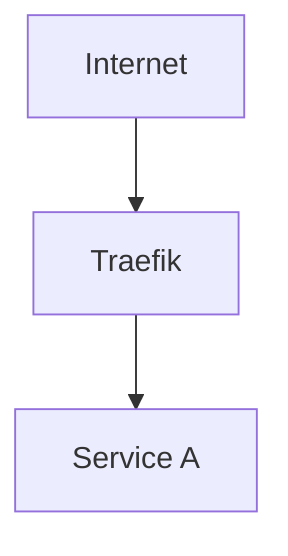
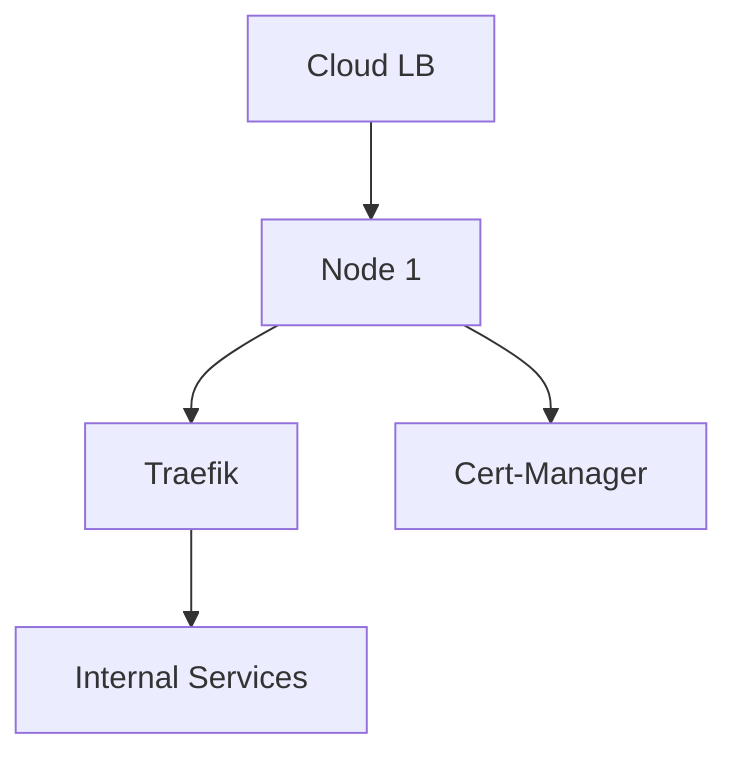

# AGENTS.md — 04_ADRs

Architectural Decision Records. The final greenlight — committing to a path forward.

## Why have ADRs?

To document why decisions were made. ADRs answer "why did we do it this way?" months or years later. They include mermaid diagrams showing how the solution works and how it fits into the homelab. Alternatives are not discussed here — they were handled in Research.

## When to create

After Research is accepted. Every significant architecture or technology choice needs an ADR.

## Status Lifecycle

```
draft → accepted → (proceed to 05_Implementations/)
  L__> archived → (move to 06_Archive/adrs/)
```

- **draft**: Proposed, under review
- **accepted**: Decision made — create an Implementation
- **archived**: Deprecated or superseded

## Frontmatter (required)

```yaml
---
adr: NNNN
title: ""
author: ""
status: draft        # draft | accepted | archived
topic: ""
technology: ""
date: YYYY-MM-DD
date-proposed: YYYY-MM-DD
replaces: ""
replaced-by: ""
history: ""
sources: []
references: []
related_docs: []
---
```

Example:

```yaml
---
adr: 42
title: "Deploy Traefik as ingress controller"
author: "padawont"
status: draft
topic: "networking"
technology: "traefik"
date: 2026-08-13
date-proposed: 2026-08-10
replaces: ""
replaced-by: ""
history: "PR #42 — discussion and approval"
sources: []
references:
  - url: "https://doc.traefik.io/traefik/"
    title: "Traefik documentation"
related_docs:
  - "./03_Research/ingress-comparison/overview.md"
---
```

See `./Templates/adr/adr.md` for a copyable template.

## Structure

The ADR follows the layout of `./Templates/adr/adr.md` — headings, diagram type and order:

````markdown
# ADR-{NNNN}: {Title}

## Context and Problem Statement

What is the problem? What constraints exist? Which research informed this?

## Decision

What was decided? Why this technology?



## Fit into Homelab

How does this integrate with existing infrastructure?


````

## Conventions

- Naming: `{issue-number}-{kebab-description}.md`
- Use GitHub issue number as ADR number
- Every ADR must trace back to its Research doc via `related_docs`
- `draft → accepted` requires a review (PR with at least 1 approving review)
- Every ADR must contain at least two mermaid diagrams:
  1. How the solution works internally
  2. How it fits into the homelab
- No alternatives or considered options section — those belong in Research
- Duplicates and contradictions with another note or ADR are `overlap` findings — link instead of repeating (`./.opencode/REVIEW.md` § The Five Facets)

## Agent Behaviour

Role permissions and handoff contracts are shared across sections — see the roster in
`./.opencode/WORKFLOW.md` and the per-role contracts in `./.opencode/agents/`; the review
facets and the report shape are owned by `./.opencode/REVIEW.md` § The Five Facets.

No spoke asks the human. Anything unresolved returns in the spoke's own report — the
editor's `questions:`, or `unresolved` in the merged envelope — and `runesmith` routes it
(`./.opencode/WORKFLOW.md` § Escalation, `./.opencode/REVIEW.md` § Verdict Precedence).
