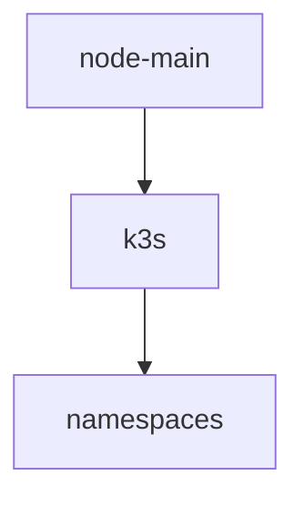

# {Cluster Name} — Spec

<!-- Descriptive spec: what the cluster actually is right now. Append-only — never modify or delete an existing line; corrections are new appended sections. -->

## Nodes

<!-- One line per node: hostname, role, IP, hardware. -->

## k3s Version

<!-- Exact k3s version and how it was installed. -->

## Namespaces

<!-- Every namespace and what lives in it. -->

## Cluster Diagram

<!-- Replace the placeholder below with the real diagram. Never edit it in place after a change — append a new replacement block instead. -->

