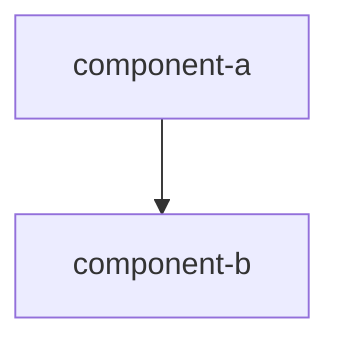

# {Service Name} — Service Stack

<!-- Descriptive spec: what this service is made of right now. Append-only — never modify or delete an existing line; corrections are new appended sections. -->

## Tools
<!-- The tools this service is built on. -->

## Languages
<!-- Languages and their roles. -->

## Versions
<!-- Pinned versions, as deployed. -->

## Ports
<!-- Ports exposed and what each is for. -->

## Dependencies
<!-- Other services, data stores, or infrastructure it relies on. -->

## Component Diagram
<!-- Replace the placeholder below with the real diagram. Never edit it in place after a change — append a new replacement block instead. -->

