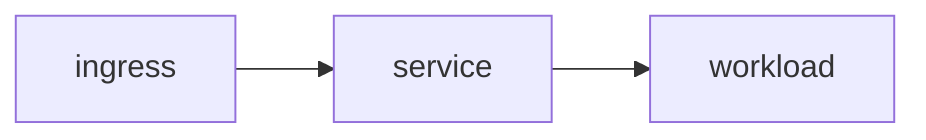

# {Service Name} — Topology

<!-- Descriptive spec: how this service is wired right now. Append-only — never modify or delete an existing line; corrections are new appended sections. -->

## Ingress

<!-- Ingress host, class, TLS, and routing. -->

## Service

<!-- ClusterIP / ports / selectors. -->

## Workload

<!-- Deployment or StatefulSet, replicas, image, node. -->

## Flow Diagram

<!-- Replace the placeholder below with the real diagram. Never edit it in place after a change — append a new replacement block instead. -->

